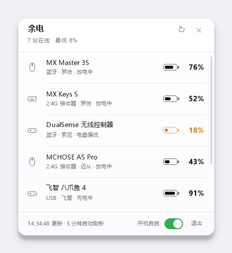
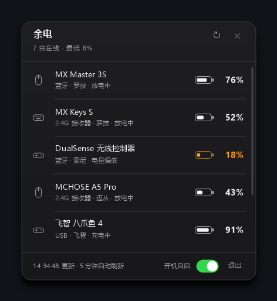
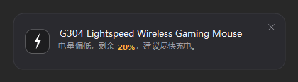
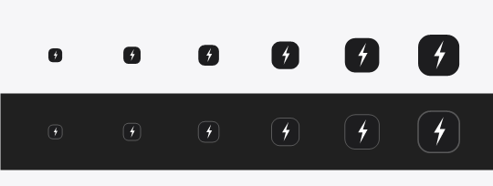
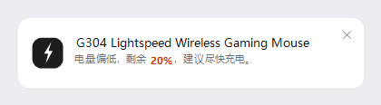
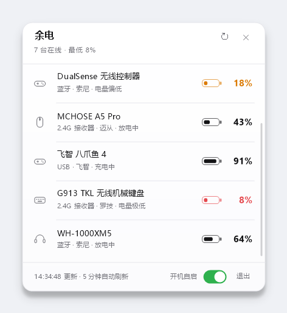
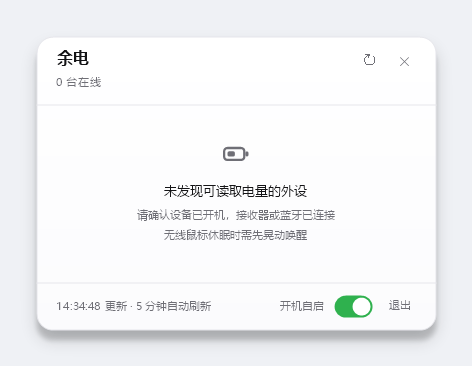
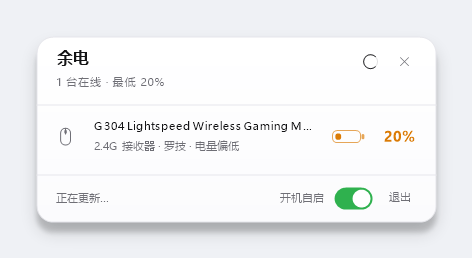

# 余电 · 技术说明

> 这份文档讲的是**怎么实现的**：设计取舍、协议细节、排查步骤。
> 想先弄清「这是什么、文件都在哪」，请看 [`../README.md`](../README.md)。

Windows 托盘常驻小工具，读取无线鼠标 / 键盘 / 手柄的实时电量。原生 C++ / Win32 实现，**单文件 597 KB**，不依赖运行时，也不需要任何厂商驱动。



深色主题（提示卡同样跟随，卡片用「浮层色」而不是窗口底色，纯黑会像在壁纸上挖了个洞）：





主题**在运行中跟随系统切换**：托盘程序可能连着跑几天，只在启动时读一次配色的话，中途切成深色就会留下一张白得刺眼的卡片。窗口收到 `WM_SETTINGCHANGE`（`ImmersiveColorSet`）后重新解析配色并重绘面板与提示卡。

## 设计

界面和图标走苹果那套系统语言，不是「画得像 macOS」，而是遵守同样的几条规则：

- **单色**。正常电量只用近黑 / 近白，只有 ≤20% 才上橙、≤10% 才上红。彩色电量条会立刻变成仪表盘，不像系统组件。
- **细发丝线**。分隔线 1px、`#E6E6EB`（深色 `#3A3A40`），画在 `.5` 像素上——画在整数坐标会被摊成两条半透明线。列表分隔线从文字起始处起，不贯穿图标区，iOS 表格的做法。
- **无卡片**。列表行不垫底色块，图标就是图标；悬停时才浮出一层淡底。
- **数字用 Segoe UI**，中文用微软雅黑。Segoe UI 的字面比例更接近 SF Pro，`76%` 这种数字放在一起不会忽宽忽窄。
- **圆角 16px**，卡片自上而下约 2% 的亮度渐变——只负责「有厚度」，能看出色差就过了。底色不是纯白而是偏冷的浅灰（`#F7F8FA`）：纯白贴在白色窗口上会糊成一张纸，浅灰才像一块有厚度的材质。
- **右键菜单用系统的**，不自绘：键盘操作、子菜单、勾选状态都是现成的，自绘一遍只会丢功能。Win11 上菜单一出现就给它补 `DWMWA_WINDOW_CORNER_PREFERENCE`，拿到原生圆角和阴影；Win10 的系统菜单本来就是方角，保持原样才像那个系统。
- **分层窗口自绘**：四周是两层叠加的高斯阴影（贴地一层收紧、环境一层散开），不是系统的硬边 `CS_DROPSHADOW`。
- **卡片是不透明的**。做过一版「毛玻璃」：把卡片背后的桌面抓成一张模糊图铺上去。问题是那张图是照片，桌面一变就成了「已经不存在的东西」；改成定时重拍又有停顿感、拖动时更明显。性价比不对，已整体去掉——1px 描边 + 柔和阴影足够把卡片和背景分开。

托盘图标**就是程序图标**——墨色圆角方块 + 白闪电，恒定不变，不显示电量数字。任务栏里放一个会变的数字会一直抓到余光，而且和 exe 图标不是同一个东西；电量看面板、悬停提示和低电量提醒。

**深色任务栏不会把图标翻成白的**：翻色之后托盘是白方块、提示卡是黑的，同一个程序出现两套视觉。现在统一墨底，只在深色下补一圈 25% 白描边——墨底和深色任务栏（`#202020`）太接近，没有轮廓就只剩一个白闪电悬在那儿。16px 下这圈描边仍然连续，实测见 `images/preview-tray.png` 下排。



低电量提醒不用系统的气泡（那是 Windows 画的：黄色警告三角、灰色图标、系统字体，和程序完全脱节），自己画了一张卡片：圆角、发丝线、左侧就是程序图标，百分比在正文里单独染色加粗——数字不进图标，36px 的方块塞两位数既不清楚、也和正文重复。6 秒后自动收起，右上角 × 可关，点卡片其它位置打开面板：



**面板一定关得掉、也一定退得掉**。托盘浮层最容易犯的错是：点开之后没有关闭按钮，也没有退出入口，用户只能去任务管理器。默认贴住工作区右下角（任务栏正上方，留 8px），标题栏右侧是刷新和 ×，页脚右侧是「退出」：

- `×` 只收起面板，程序还在托盘里，再点托盘图标就回来
- 「退出」要点两次：第一次变成红色「确认」，页脚同时提示「再点一次」；4 秒内不再点、或者点了别处，都自动撤销。退出程序不该是一击即中的操作
- 面板任意位置右键也能出菜单（打开 / 刷新 / 自启 / 刷新间隔 / 回到右下角 / 退出）
- 换显示器、改缩放时重新锚定，不会把面板甩到屏幕中间，也不会压到任务栏底下

**面板可以拖走**。按住标题栏空白处（不是按钮上）拖动，指针变成四向箭头，松手后位置记进配置；下次打开还在原处。这是给"输入法工具条、屏幕键盘挡住面板底部"这种情况留的出口：

- 拖动时整块面板（含阴影）跟手移动，不做重绘，只有位置在变
- 松手前一直按**卡片矩形**夹在工作区内：拖到屏幕外只会停在边缘，不会剩一条边留在屏幕外
- 记住的位置在显示器拔掉 / 分辨率变化后会失效并自动回到右下角；右键菜单里也有「面板回到右下角」手动复位

**设备增删只在你看得见的时候播动画**。判据不是"手动还是自动刷新"，而是面板此刻是否开着——后台每 2 分钟扫一次，只要面板开着，结果里的增删同样会过渡：

| 场景 | 行为 |
|---|---|
| 面板开着，多了设备 | 新行从 0 展开，内容在末段淡入；行数到 5 行上限时，先收离场行再进场，避免新行被挤到可视区外 |
| 面板开着，设备消失 | 内容先快速淡出、高度收拢，下方行平滑上移，收完才真正从列表删除 |
| 面板收着 | 不播动画，直接换成最终列表；下次打开就是结果（打开本身有淡入上浮） |

**休眠不算消失**：这一轮没扫到不等于设备没了。罗技静默通道、Compx 接收器无应答都会产出"设备休眠"记录，这些行不会被误删。真正的移除只发生在设备从扫描结果里彻底消失时：手动刷新当轮剔除，自动轮询给一轮宽限，第二轮仍然没有才删——防止蓝牙瞬断把设备删掉又加回来。

## 特性

- **托盘图标与程序图标完全一致**（墨底白闪电方块，浅色 / 深色任务栏同一套），不显示数字
- **面板可拖动、位置记忆**：按住标题栏就能挪，松开自动吸附在屏幕内，右键可复位到右下角
- **设备增删有过渡**：面板开着时，设备接入/移除会展开/收拢，不会凭空出现或消失
- **柔和阴影 + 动效**：分层窗口自绘两层高斯阴影；打开时淡入上浮，悬停淡入、开关滑块滑动都是插值的，不是硬切
- **标题栏 × 关闭、页脚「退出」**（二次确认，点别处自动撤销）
- **低电量提醒**是自己绘制的卡片，不是系统气泡；6 秒自动收起，右上角有 × 可关，点卡片其它位置打开面板
- **刷新有明确反馈**：按钮有悬停/按压态，点击后转环形进度圈，页脚立刻显示「正在更新…」
- **点一下看全部设备**：型号、连接方式、电量、充电状态、最后更新时间
- **休眠友好**：无线设备空闲休眠时保留最后一次读数，标注「休眠 / 未连接」和距上次读取的时长，不会从列表里消失。**保留上限 15 分钟**：超过之后百分比显示 `--`、状态改为「长时间无响应」——电池耗尽或鼠标关掉后，旧数字不会一直挂在那里装作是现在
- **低电量气泡提醒**（默认 20%，可调）
- **开机自启**开关（写 HKCU Run 项，无需管理员权限）
- **刷新间隔**可调（1 / 2 / 5 / 10 / 30 分钟，默认 2 分钟）
- **深浅色主题**自动跟随系统，运行中切换也会立刻生效（含已弹出的提示卡）
- **单实例**：重复启动只会把已有面板叫出来

设备超过 5 台时可滚轮滚动，右侧有细滚动条：



空状态：



刚点开、还在扫描时（图标转圈 + 一行说明，不会先闪一个"没有设备"）：



## 资源占用（本机实测）

| 指标 | 实测值 |
|---|---|
| exe 体积 | 611,328 字节（597 KB，含 9 尺寸图标，静态链接已去除符号） |
| 空闲内存 | 23.7 MB（工作集，托盘常驻，多轮扫描无增长） |
| 单次扫描 | **125 ms**（稳态）／ 1.2 s（首次全量，含冷启动） |
| 高 DPI | 支持 Per-Monitor V2，150% 缩放下按 1.5 倍绘制 |
| 冷启动 | < 200 ms |
| 依赖 | 无。仅系统 DLL + `ucrtbase.dll`（Win10 自带） |

## 轮询频率与耗电

**默认 2 分钟，不是 30 秒。** 这不是为了省资源而牺牲体验——30 秒这个量级对电量本身就没有信息增益：

- 一只无线鼠标满电通常能用 50~100 小时，**掉 1% 要 30~60 分钟**；键盘更慢。30 秒轮询十次，读到的还是同一个数。
- 真正需要"新鲜数字"的时刻是你打开面板的时候，而面板**打开即刷新**（数据超过 3 秒就重新扫一次），手动刷新还会做全量探测。后台轮询只负责托盘提示和低电量提醒的兜底，2 分钟完全够。

### 对鼠标 / 键盘的电池

每次轮询只做一件事：往接收器发一条读命令（罗技 HID++ 7 / 20 字节，Compx 17 字节），设备回一帧。整个射频交互是**毫秒级**的，按 2 分钟一次算占空比约 0.002%，比传感器和主控的日常功耗低好几个数量级，续航上测不出来。

更关键的是**它不会把设备叫醒**：设备睡着时根本不回包（面板上显示"设备休眠"就是这种情况），查询只是等一个超时。所以不存在"轮询让鼠标一直醒着"的问题。

### 对电脑

稳态一次扫描约 125 ms，其中一半花在枚举 HID 接口上：

| 间隔 | 平均 CPU 占用 | 每小时唤醒次数 |
|---|---|---|
| 30 秒 | 约 0.4% 单核 | 120 |
| 2 分钟（默认） | 约 0.1% 单核 | 30 |
| 5 分钟 | 约 0.04% 单核 | 12 |

常驻内存 23.7 MB。对台式机完全无感；对笔记本，差别主要在**唤醒次数**——2 分钟比 30 秒少四分之三，待机时更友好。想更灵敏可以选 1 分钟，纯电池供电的笔记本选 10 / 30 分钟也行。

## 支持范围

| 设备类型 | 读取方式 | 状态 |
|---|---|---|
| 罗技无线键鼠（Lightspeed / Unifying / Bolt 接收器） | HID++ 2.0 特性 `0x1000` / `0x1001` / `0x0005` | **已实测通过**（G304 Lightspeed） |
| 罗技蓝牙直连、有线设备 | 同上，通道 `0xFF` | 已实现 |
| 罗技 M185 / M186 / M220（C542 Nano 接收器） | **没有 HID++ 通道，硬件不上报电量** | 能识别，面板标注「硬件不支持读数」 |
| PS5 DualSense / DualSense Edge（**USB 有线**） | 输入报告 `0x01`，电量在第 53 字节 | **已实测通过**（本机，USB 充电中） |
| DualShock 4（**USB 有线**） | 输入报告 `0x01`，电量在第 30 字节 | 已实现 |
| PS5 DualSense（**蓝牙**） | Windows 蓝牙栈只给简化报文 `0x01`，**不含电量字段**；完整的 `0x31` 报文电量在第 54 字节 | 能识别，标注「蓝牙不提供电量」；插数据线即改走 USB 读取 |
| DualShock 4（**蓝牙**） | 完整报文 `0x11`，电量在第 32 字节 | 已实现 |
| 其它按 HID 规范上报电量的蓝牙键鼠 | 需要解析 Report Descriptor 定位电量字段 | **暂不可用**：Windows 用户态拿不到原始描述符（见下），这条兜底目前不产生读数 |
| **VGN 蜻蜓 / ATK / VXE / Zaopin / Scyrox / 达尔优 / G-Wolves / Pulsar**（Compx 2.4G） | usage `0xFF02/0x0002` 的 17 字节厂商集合：`0x08 0x04` 读电量（第 6 字节百分比、第 7 字节插线、第 8~9 字节 mV），`0x08 0x10` 读型号 | 按接收器动态识别，型号由设备自报；协议照 PowerPeek 的 **VGN 蜻蜓 F1 MOBA 实机记录**，本机待真机验证 |
| **ATK Zero**（Nordic 54L15） | 64 字节报文 `0x08`/`0x72`，电量在第 7 字节 | 已实现，待真机验证 |
| **迈从 A5 V3 Pro**（`3837:1018`，协议 V2） | 64 字节输出报告 `0x4D`，命令 `0x0900`，XOR 校验 | **已实测通过**（本机，100%） |
| **迈从无线键盘接收器**（`41E4:2001`，协议 V1） | 20 字节报告 `0x13` + `0x4A`，末字节求和校验 | **已实测通过**（本机 K99 V2，94%） |
| **飞智 Vader 5 Pro**（`37D7:2401`，新协议） | `0xFFA0` 上 33 字节报文，`5A A5 01 02 00` 取设备信息，电量在应答第 11 字节 | **已实测通过**（本机 USB 有线 100%、2.4G 接收器均通过） |
| **BLE 外设**（鼠标 / 键盘 / 手柄里带 GATT 的） | Battery Service `0x180F` → Battery Level `0x2A19`，走 `BluetoothApis.dll` 的 GATT 客户端 API | 已实现；**要求设备处于连接态**，掉线时读不出值（详见「关于蓝牙」） |
| **经典蓝牙音频**（华为 FreeBuds / FreeClip 这类耳机、音箱） | 系统里没有任何电量属性，GATT 也没有节点，只有 HFP 的 AT 指令拿得到 | **未实现**，见「关于蓝牙」 |
| **雷柏 M200 / M200G / M200G Plus**（2.4G 接收器 `24AE:2015`） | **没有电量通道**：接口里没有标准电量字段；游戏系列的 `0xFF00/0x000E` 私有通道（report `0xBA`）在这颗办公接收器上对握手、读寄存器、读电量全程无应答；唯一能读的 8 字节特性报告是固定信息（实测鼠标持续活动 54 秒，零变化） | 能识别，面板标注「硬件不支持读数」 |
| **MCHOSE L7 Pro**（Realtek `0xFF01`） | 被动接收设备推送的 `0x13`/`0x1D` 报告，整帧 XOR 0xFF | 已实现，待真机验证 |
| 迈从其它型号、飞智老一代（走经典 `05 EC` 协议） | — | **未实现**，见下 |

### 关于蓝牙

两条完全不同的路，别混：

1. **BLE（低功耗）设备** —— 标准 Battery Service `0x180F`。程序通过
   `BluetoothGATTGetServices` / `GetCharacteristics` / `GetCharacteristicValue`
   直接读 `0x2A19`。三个前提：已配对、**当前处于连接态**、固件没裁掉 BAS。
   服务表是系统缓存的，所以「能列出服务」不等于「能读到值」——掉线时读会返回
   `0x80070001`（ERROR_INVALID_FUNCTION）。命令 `--ble` 会把这些状态直接打出来。
2. **经典蓝牙音频设备** —— 华为 FreeBuds Pro 3 / FreeClip 2 在本机就是这一类：
   只有 `BTHENUM\DEV_*` 节点和 A2DP / HFP / AVRCP 服务，**没有 BTHLEDEVICE 节点**，
   设备属性里也没有任何 Battery/Charge 字段（已逐条枚举确认）。它们的电量只存在于
   HFP 的 AT 指令里（`AT+CIND?` 的 battchg、或厂商私有 AT），而 PC 侧的 HFP 链路
   已经被 Windows 自己的免手操驱动占着，再连一条会影响通话和播放。**所以这一类不做。**

顺带记一笔：GATT 的「先问数量」调用 `BluetoothGATTGetServices(h, 0, …)` **本身就返回
`ERROR_MORE_DATA`**，那是正常行为，把它的 HRESULT 当失败判会永远读不到东西；另外
`BluetoothGATTGetCharacteristicValue` 是 **6 个参数**（第 5 个回填需要的字节数），
少传一个会直接崩在 API 里。

### 关于国产外设协议

VGN、ATK、VXE、Zaopin、Scyrox、达尔优、G-Wolves 这些牌子**用的是同一套 Compx 2.4G 接收器固件**，帧格式完全一样——换型号只是换 VID/PID 和型号号。

之前的版本是"查 VID/PID 表 + 发 17 字节请求"，VGN 蜻蜓一直读不出来，原因有四个，现在都改了：

1. **选错集合**。同一颗接收器会暴露好几个 HID 集合，只有 `usage 0xFF02/0x0002` 且**输入输出都是 17 字节**的那个厂商集合能写；以前取"第一个匹配"，很可能拿到 8 字节的鼠标集合，写 17 字节必然失败。现在按报告长度筛，并且同一接收器的多个集合会逐个试。
2. **只认表里的 PID**。新型号换 PID 就整台设备被跳过。现在只要 VID 属于 Compx 同族（`3554` / `373B` / `260D` / `33E4`），或者产品名里带 VGN / VXE / ATK / Pulsar 等同族品牌，就按这套协议试。
3. **回包不做校验**。帧尾是校验字节（整帧求和 = `0x55`），回复同样要校验；以前直接读第 6 字节，噪声会被当成电量。现在校验、状态字节、长度、`0% + 0mV`（接收器后面没鼠标）都判。
4. **一次读不到就放弃**。接收器大约每 30 次请求会丢一次，现在丢包重发（3 次 × 120 ms），实测正常回包只要 1~23 ms。

型号（customer/model）由接收器自己报，所以面板上能直接显示 **VGN 蜻蜓 F1 MOBA**、**F1 Pro Max**、**F1 S** 这些具体型号，而不是笼统的"VGN F1 Pro"；VGN 整个 F1 系列共用一个接收器 PID，靠 PID 是分不出来的。

迈从有三代协议，程序按**接口形状**自动选，不查型号表：

1. **V2（新，`3837` 这一代）**：厂商集合 `0xFF01/0x0001`，64 字节**输出报告 `0x4D`**（ASCII `'M'`）。帧头 `4D 01 01`，命令 `0x0900` 取设备状态，XOR 校验覆盖 `[2]..[7+N]`。应答里带 VID/PID、连接方式、充电状态和电量。
   写入要用**同步句柄**，读用**另一个异步句柄**——同一个异步句柄既写又读，输入报告会静默，看起来就像设备休眠。命令发错通道时设备照收不回，这是最初读不到 A5 V3 的主因。
2. **V1（`41E4` 这一代的接收器）**：20 字节报告集合 `0xFF02/0x0002`，写 `13 4A 01 00`，应答第 6 字节是电量、第 7 字节是状态，末字节 = 前 19 字节求和。
3. **旧 L7 Pro（`5253`）**：Realtek 方案，电量不在请求应答里，设备自己每隔约 2 秒推一条 `0x13` 报告。本程序**只被动接收**，不发厂商 nudge 命令。

两代都**不发设置类命令**：只发读状态的 `0x0900` / `0x4A`，不碰 DPI、轮询率、固件。

### 关于飞智 Flydigi

Vader 5 Pro 这一代换了新协议（VID `0x37D7`，SDL 里叫 V2），走 `0xFFA0` 接口，33 字节报文（首字节是 report id `0`）：

```
请求  00 5A A5 01 02 00 …            # 取设备信息
应答  00 5A A5 01 <total> <idx> …    # 第 6 字节连接方式，第 12 字节电量
```

- 电量字节：高 4 位 `0` 放电 / `1` 充电 / `2` 充满，低 4 位是**档位 × 20%**——协议只给 0/20/40/60/80/100 六档，不是精确百分比。
- 第 7 字节是连接方式：`1` 有线、`2` 无线（接收器）。
- 写要用同步句柄、读用异步句柄（和迈从 V2 同一个坑）；另外这台设备**隔一次才应答**，所以读失败要重试，现在固定试 3 次。

### 设备名字读不出来怎么办

有的接收器只报通用名——迈从 `41E4:2001` 就是典型：产品名固定 `MCHOSE 2.4G Wireless`，厂商字段还是芯片商 `Compx`，`0x41`/`0x42`/`0x44` 读块命令的寄存器里也没有 ASCII 型号，整个 `0x13` 命令空间扫完都没有字符串。

这种情况在 `%APPDATA%\PeripheralBattery\config.ini` 里加一行别名即可（键是 `--dump` 里的 VID:PID，四位大写十六进制）：

```ini
name.41E4:2001=MCHOSE K99 V2
```

面板、托盘提示、低电量提醒都用这个名字。

协议出处（全部公开实现）：

- [k0te1ch/powerpeek](https://github.com/k0te1ch/powerpeek) — `src/battery/CompxProtocol.*`，Compx 帧格式、校验、型号查询，附 VGN 蜻蜓 F1 MOBA 的实测帧
- [Fan4Metal/ATK_tray](https://github.com/Fan4Metal/ATK_tray) — Compx/Nordic 52840 的报文格式与型号表
- [Fan4Metal/mouse_tray](https://github.com/Fan4Metal/mouse_tray) — `chipset/nordic52.py`、`chipset/nordic54.py`、`chipset/realtek.py`
- [XAVIER0229/GearPower](https://github.com/XAVIER0229/GearPower) — 迈从 K7 Ultra 实机验证（Realtek 方案）
- [ericzuobin/flydigi-space-station-mac](https://github.com/ericzuobin/flydigi-space-station-mac/blob/main/docs/adding-a-controller.md) — `0x37D7` 新协议的 `5A A5` 帧格式、`0x01` 信息应答字段表（Vader 5 Pro 实测）
- [libsdl-org/SDL](https://github.com/libsdl-org/SDL/blob/main/src/joystick/hidapi/SDL_hidapi_flydigi.c) — SDL 的飞智 HID 驱动（zlib），报文长度与 report id 的旁证

**我手上没有 VGN 真机，代码是照公开的实测协议写的。**读不到时按顺序跑这两条：

```
yudian.exe --dump hid.txt
yudian.exe --vendor vendor.txt
```

`hid.txt` 是所有 HID 接口的 VID/PID、Usage Page、报告长度，能看出设备有没有暴露 17 字节的厂商集合；`vendor.txt` 是每个候选接口发 `0x04` / `0x10` 的**原始十六进制帧**和解析结果，直接能定位是"没应答""校验不对"还是"集合选错"。

### 安全边界

这个程序**不安装任何驱动、不写注册表驱动键、不刷固件**，只做三件事：枚举 HID 接口、发读取查询、收回报。读取电量永远不需要管理员权限。

如果某个工具要求你装 `.inf`、加载 `.sys`、或者"以管理员身份安装驱动"，那不是这类工具该做的事，别装。

## 辅助命令

| 命令 | 用途 |
|---|---|
| `--list <文件>` | 扫描一次并把结果 + HID++ / Compx 诊断写进文件（第一段是一行汇总：几台、几台可读、失败按原因分类、各链路耗时） |
| `--selftest [文件]` | 跑一遍纯函数断言（默认写 `selftest.txt`）。全过退出码 0，有失败退出码 1；`build.bat` 拿它当门禁 |
| `--vendor <文件>` | 只导出 VGN / VXE / ATK 这类 Compx 接收器的原始帧与解析结果 |
| `--raw <文件>` | 把每个 HID++ 请求的原始十六进制帧打出来，用于逆向未知协议 |
| `--mock` | 用 7 台演示设备跑界面，没有硬件时预览 |
| `--shot <png> [demo\|dark]` | 离屏渲染面板截图 |
| `--shot-seq <前缀> <帧数> <间隔ms>` | 同进程连续重绘多帧，用于检测绘制抖动（帧应完全一致） |
| `--shot-tray <png>` | 渲染托盘图标各尺寸对照图 |
| `--shot-toast <png> [dark]` | 离屏渲染低电量提醒卡片 |
| `--bench <文件>` | 同一进程连扫 5 次并记录耗时，用于性能回归 |
| `--dump <文件>` | 导出全部 HID 接口（VID/PID、Usage、报告长度），排查新设备用 |
| `--ble <文件>` | BLE 电量诊断：列出处于连接态的 BLE 设备、能否读到 `0x180F/0x2A19`、失败时的 HRESULT |
| `--make-ico <路径>` | 用同一套绘制代码重新生成 `app.ico`（9 种尺寸） |

## 使用

1. 双击 `build\yudian.exe`
2. 托盘出现电量图标
3. **左键** → 弹出面板；**右键** → 菜单（刷新 / 开机自启 / 刷新间隔 / 回到右下角 / 退出）
4. 面板：**按住标题栏拖动**可以挪位置（松手记住，拖不出屏幕）；标题栏 `↻` 刷新、`×` 关闭；页脚开关设开机自启，`退出` 要连点两次
5. 面板关了不等于程序退了——托盘图标还在，再点一下就回来

## 构建

需要 MinGW-w64（GCC 13+，UCRT 版）：

```
build.bat
```

工具链查找顺序：`%MINGW_BIN%` → `D:\toolchains\mingw64\bin` → `%LOCALAPPDATA%\Mingw64\mingw64\bin` → `..\.toolchain\mingw64\bin` → PATH。

没装工具链时，一条命令即可（WinLibs 的 UCRT 版，装完就在 `%LOCALAPPDATA%\Mingw64\mingw64\bin`）：

```
winget install --id BrechtSanders.WinLibs.POSIX.UCRT -e
```

**重要**：`ld.exe` 无法处理含非 ASCII 字符的工具链路径，MinGW 必须放在纯英文路径下（例如 `D:\toolchains\mingw64`）。源码目录可以含中文，只有工具链路径要求 ASCII。

关键编译参数：`-static -s`（静态链接 + 去符号）、`-mwindows`（无控制台）、`-municode`（`wWinMain`）。

构建脚本会用 `objdump` 复核 PE 子系统必须是 `00000002 (GUI)`。**如果不小心编成控制台子系统（`00000003`），双击时会弹出一个空黑窗口**——手动编译漏掉 `-mwindows` 就会这样，所以这道检查留在脚本里。

编完会立刻跑一次 `--selftest`（纯函数断言，22 条）：**失败则整个构建失败**，并把新 exe 改名成
`build/yudian.broken.exe`，避免留下一个"能双击但已经坏了"的程序。结果在 `build/selftest.txt`。

想看编译器警告（不阻断）：

```
build.bat check
```

用 `-Wall -Wextra` 另编一份到 `build/yudian.check.exe`，条数与日志在 `build/warnings.txt`。
目前剩下 6 条：2 条是 MinGW 忽略 `#pragma comment`，4 条是 `GetProcAddress` 的标准函数指针转换，都属预期。

## 改配置的兼容约定

`%APPDATA%\PeripheralBattery\config.ini` 第一行是 `schema=N`。规则：

- **写**：先写 `config.ini.tmp`，整份写完再 `MoveFileEx` 替换正式文件。写到一半断电时，正式文件仍是上一版完整内容。
- **读**：没有 `schema` 键的文件按 0 处理，交给 `MigrateConfig()` 统一升级；迁移改了值就立刻回写一次。
- **加规则**：`kConfigSchema` +1，在 `MigrateConfig()` 里加一个 `if (fromSchema < N)` 分支。不要在 `Load()` 里散着写。

## 协议实现笔记

踩过的坑，记下来免得重走：

0. **图标里的数字用 GDI 画、不是 GDI+**。GDI 有字体微调，小字号下比 GDI+ 锐利；但 GDI 写进 32bpp ARGB 会把 alpha 记成 0（图标会整块消失），所以先画到黑色 DIB，再把亮度当 alpha 搬到 ARGB 位图。
1. **特性 ID 的字节序不统一**。HID++ 2.0 规范是小端，但这台 Lightspeed 接收器（PID `C53F`）按**大端**解析：发 `00 10` 返回索引 0（不支持），发 `10 00` 才返回正确索引。代码先试小端、失败再试大端，并按设备缓存结果。
2. **长报文接口才是真正干活的**。同一接收器暴露两个 HID++ 集合：`usage 0x0001` 短报文、`usage 0x0002` 长报文。这台设备只在长报文集合上响应，短报文集合对已配对通道直接超时。
3. **错误帧的错误码在第 6 字节**：`[id, devIdx, 0x8F, 地址, 功能|swid, 错误码, 0]`。`0x08` = 未知设备，`0x01` = 无效子命令。
4. **通道静默 = 设备休眠**，通道明确报 `0x08` = 没有配对设备。两者要区分开。
5. **设备名分片方式有两种**：返回分片数（≤8，参数是分片序号）或返回字节长度（>8，参数是字节偏移）。按返回值大小自动判断。
6. HID++ 请求唤不醒休眠设备，这是协议限制。鼠标停一秒就睡，所以读取要趁它醒着。
7. **超时不能当成"休眠"**。最初只要通道没应答就生成一条"设备休眠"占位记录，结果超时一多，一台接收器上凭空多出 5 台"休眠设备"。正确逻辑是：只有**确认存在过**的通道（本进程内应答过、或已有名字缓存）静默时才代表休眠。
8. **设备名要缓存**。名字每次要发 3 个分片请求，设备慢的时候每个都可能吃满 200ms 超时——这一项单独就能把扫描拖到 600ms。
9. **`volatile` 不等于线程安全**。扫描线程与 UI 线程共享的 `g_quit` / `g_intervalSec` / `g_forceScan` 原来是 `volatile`，它在本平台能跑，但标准上不建立 happens-before，属于 data race。已换成 `std::atomic`（这几个都是字长以内、无锁实现，没有引入额外开销）。
10. **同一台设备可能被多条链路各报一次**。厂商协议的设备若同时暴露标准 HID 电量页，就会出现两行一样的记录。现在通用兜底会跳过已被厂商表接管的 VID/PID，厂商扫描也按 VID:PID 合并（同一设备常有短报文 / 长报文两个集合）。
11. **别把缓冲区实际大小写错**。`wchar_t buf[160]` 却写 `swprintf(buf, 192, ...)`，当前文案不会越界，但这是拿未来的一次改动赌运气。
12. **别每轮盲扫全部通道**。接收器通常只有一个报文集合会应答、只有 1~2 个通道挂着设备。记住上一轮能用的集合与通道，稳态扫描从 2.8 秒降到 125 毫秒。
13. **同一个接收器上，能写的只有一个集合**。Compx 接收器把厂商集合、鼠标集合、键盘集合都挂在 `0xFF02/0x0002` 下，只有**输入输出都是 17 字节**的那个接受 17 字节写。按 VID/PID 取第一个匹配，十有八九拿到 8 字节的鼠标集合——VGN 一直读不出电量就是这个原因。
14. **帧尾校验是 `0x55 - sum(前 16 字节)`**，请求和回复都要算。`0x08 0x04 ... 0x49` 里的 `0x49` 不是魔法数，是校验。
15. **回包第 2 字节是状态，不是数据**。状态非 0 或 `0% + 0mV` 都表示"接收器后面没有鼠标"，把它读成 0% 会对着一个只是关了机的鼠标报"电量耗尽"。
16. **型号比 PID 准**。VGN 整个 F1 系列共用一个接收器 PID，只有 `0x10` 命令能让鼠标自己报 customer/model（`2:6` = 蜻蜓 F1 MOBA）。型号表就是靠这个把名字落到具体型号上的。
17. **面板的落点要跟着锚点走，不是跟着建议矩形走**。`WM_DPICHANGED` 给的 `RECT` 是系统建议位置，直接用它会在缩放变化后把贴右下角的面板甩到屏幕中间；按工作区右下角重算，换显示器也不会跑偏。
18. **分层窗口上不能用 ClearType**。亚像素抗锯齿依赖不透明底色，画在带 alpha 的画布上会渗色；换成灰度 AA（`TextRenderingHintAntiAliasGridFit`），代价是笔画略柔，但在任何壁纸上都成立。
19. **`UpdateLayeredWindow` 要预乘 alpha**。GDI+ 画出来是直通 alpha，直接交给系统会有一圈白边/黑边；逐像素乘一遍再提交，全不透明的像素走 memcpy 快路径，乘法查 64KB 表——一次重绘约 1 ms。
20. **命中测试要减掉阴影余量**。窗口比卡片大一圈（`SHADOW_MARGIN`），鼠标坐标不先减掉 margin，按钮会整体错位；阴影区返回 `HTTRANSPARENT`，否则点影子也会把面板激活。
21. **阴影要缓存**。两层高斯（3 次盒式模糊 × 2）如果每帧现算就是几毫秒起步，按"尺寸 + 主题"缓存，只有改缩放/切主题才重做。
22. **`ShowWindow(SW_HIDE)` 自己也会发 `WM_ACTIVATE`**。用它来"记录失焦时间"会把主动关闭（×、Esc）也算成失焦，下一次点托盘就被 260 ms 防抖吞掉；加 `g_hidingSelf` 区分主动收起。
23. **"没有动画条目"的行也必须能播离场**。面板收着时直接替换过列表，那些行没有 `p` 状态；标记离场时若只在"条目已存在"的分支里做，它们会直接跳没。离场标记要顺手把条目建出来。
24. **列表满 5 行时不能同时收和进**。离场行还占着位置，新行会被挤到可视区外，进场动画等于没播。改成两拍：先收完离场行，再按新顺序插入新增行。
25. **进场的前 2/3 不画内容**。行高从 0 长起来时，裁剪会露出顶部一截文字（比如半行百分比），看起来像排版坏了；先让空行撑开、最后 1/3 段再淡入内容，观感干净得多。
26. **`0x4D` 是输出报告，不是特性报告**。A5 V3 的帧头 `4D 01 01 …` 同时长得像"报文 ID"和"报表 ID"，先当成特性报告用 `SetFeature` 发了半天：设备照收，但**一个字节都不回**。实际必须 `WriteFile` 到 report `0x4D`。判别方法：`--dump` 里 `OUT` 长度 ≥ 帧长、且 `WriteFile` 不报 87，就是输出报告。另一个坑——扫报表 ID 只扫 `0x00..0x3F` 会漏掉 `0x4D`。
27. **写和读必须分两个句柄，且写用同步句柄**。同一个异步句柄既 `WriteFile` 又 `ReadFile`，输入管道会静默：连设备每秒一次的心跳都收不到，看起来像"设备休眠"，实际是自己在饿死自己。现在的做法是——同步句柄写 64 字节，另一个异步句柄专读；能不能读到，先看有没有心跳帧。
28. **迈从 V1 的应答校验是"前 19 字节求和"**，不是 Compx 的 `0x55 - sum`。请求 `13 4A 01 00` 反而不带校验——尾部全零时接收器照收。
29. **别把"没有区别"当成"没有影响"**。键盘接收器（V1）在键盘休眠后就不再应答，和罗技一样；程序必须把"这一轮没读到"和"设备没了"分开——前者保留上一次读数并标「休眠」，后者才删除行。
30. **飞智新协议的首字节是 report id `0`，不是帧头**。`5A A5 …` 直接写在报文第 0 字节会被当成未知 report id 丢掉；正确写法是 `00 5A A5 01 02 00 …`，应答同理，帧从第 1 字节开始，所以所有字段偏移都要 +1。
31. **有些设备就是隔一次才应答**。Vader 5 Pro 连续两次同样的请求，只有一次会回；等 1.5 秒也不会回第二次。别把它当成"设备忙"去加长超时，直接重试更快——现在固定 3 次，实测 6/6 成功。
32. **电量只有 20% 一档不代表读错了**。飞智这款协议的电量字段就是 4 bit 档位（0–5），显示 80% / 100% 这种整十跳变是正常的，不是解析取错字节。
33. **产品名字符串可能是芯片商，不是品牌**。迈从键盘接收器的 manufacturer 是 `Compx`，product 是 `MCHOSE 2.4G Wireless`——两个都不能当型号用。名字只能由用户给，落到 `config.ini` 的 `name.VID:PID`。
34. **不要从"报文长度对得上"推出"字段在"。** DualSense 蓝牙的 `0x01` 报文也是 78 字节，和完整的 `0x31` 一样长，但前 8 字节之后全是补零——先前版本按 `0x31` 的偏移去读第 53 字节，读到的是补零，于是把一只满电手柄报成「0% · 电量极低」。实际的偏移按 Linux `hid-playstation` 的结构体：USB 报文第 53 字节、蓝牙完整报文第 54 字节。**先判报文类型（`0x31` / `0x11` / `0x01`+连接方式），再谈偏移。**
35. **同一只手柄的 USB 与蓝牙要合并成一条。** 充电时两路会同时存在，各报一条会让面板出现两个同名设备；按 PID 归组、USB 优先，既消掉重复，也保证优先走有电量的那一路。
36. **同一台设备的不同接口可能报不同的产品名，分组不能带产品名。** 飞智 Vader 5 Pro 有线时，XInput 那组接口报 `Controller (Flydigi Vader 5 Pro)`，厂商集合那组报 `Flydigi Vader 5 Pro`；按「VID:PID + 产品名」分组会拆成两条，其中一条没有 `0xFFA0` 集合，看起来像凭空多出一台读不到电量的手柄。只按 VID:PID 分组，显示名优先取厂商集合那条。
37. **读不到设备时不要静默丢弃整条记录。** 之前的 `ScanFlydigi` 在找不到 `0xFFA0` 时直接 `continue`，而通用兜底又因为 VID 命中被排除——两条路都堵死，面板里连一行都没有，用户只能看到「手柄插着却像不存在」。识别失败也要出一行，并在 detail 里写清实际枚举到的 `UsagePage/Usage/IN/OUT`。

## 已知限制

- **无线鼠标休眠时读不到电量**。移动鼠标或按键后下一轮刷新即可读到；面板会保留最后一次读数，**上限 15 分钟**，超过后显示 `--` 和「长时间无响应」，避免电池耗尽后旧数字一直挂着。
- **罗技鼠标的百分比是鼠标自己算的，不是本程序换算的**。G304 这类 AA 电池鼠标：新电池常见 90%（固件的满电基准高于新电池实际电压），低电量段又被压缩得很厉害——红灯慢闪约对应 15~20%，常常在 20% 附近突然断电。程序对 `0x1000` 返回的百分比只做原样显示（>100 才做掩码），不做电压曲线拟合；所以这两个数字反映的是罗技固件的估算，不是本程序的换算误差。
- **迈从 V2（A5 V3 这一代）同样不响应唤醒**：休眠时 `0x0900` 查询没有任何回包，程序会显示「设备休眠」并沿用 90 秒内的上一次读数。官方 HUB 开着时厂商集合会被独占，表现为「接口被占用」。
- **PS5 手柄的蓝牙连接读不到电量，这是 Windows 的限制**，不是程序漏读：蓝牙下 DualSense 只发「简化报文」`0x01`（78 字节里前 8 字节有效：摇杆、按键），电量所在的 `0x31` 完整报文需要 PS5 式握手，Windows 蓝牙栈完不成。实测该报文所有字节里没有电量字段，系统层面也没有任何 Battery 设备或属性。**插一根能传数据的 USB 线即可读到电量与充电状态**（充电线只供电、不出接口的那种不行）。
  早前版本会把简化报文里的全零字节当成「0%」，现在按报文类型判断，不会再谎报电量。
- **C542 Nano 接收器读不到电量**（M185 / M186 / M220 这一代）。这代接收器不实现 HID++，也没有可读的特性报表——Solaar 的兼容表明确把它列为"不实现 HID++"，罗技官方软件同样读不到。面板会把它列出来并标注「硬件不支持读数」，鼠标本体只有一个低电量指示灯。
- **仅 Windows 10 / 11（x64）**。用到 `GetDpiForSystem`、DWM 圆角等 Win10 之后的接口。
- 面板一次显示 5 行，**超过 5 台可用滚轮滚动**，右侧有滚动条。
- 蓝牙耳机等设备只有在厂商按 HID 规范上报电量时才会出现。

## 目录结构

只列本工程相关的部分，完整地图见 [`../README.md`](../README.md)。

```
app/
  src/        源码：main.cpp 入口/扫描/配置，ui.cpp 界面，providers.cpp 各厂商协议，hid.cpp 底层读写
  build/      编译产物 yudian.exe（可删，重编即得）
  build.bat   一键编译
```

## 排查

设备不显示或显示异常时：

1. 确认设备已开机，接收器插好 / 蓝牙已连接
2. 晃动鼠标让设备退出休眠，点面板右上角刷新
3. **国产鼠标（VGN / ATK / VXE …）** 跑 `yudian.exe --vendor vendor.txt`：
   - `未发现 Compx / VGN 厂商集合` = 设备没暴露 17 字节的 `0xFF02/0x0002` 集合，接收器不在同族里
   - `电量原始帧: 无应答` = 鼠标休眠、集合选错，或厂商集合被官方驱动独占
   - 有帧但 `不可用（状态 0x..）` = 接收器后面没有鼠标，或校验不对
   - `型号 x:y` = 接收器正常应答，只是型号不在表里（不影响读电量）
4. 再看 `yudian.exe --list report.txt` 的「罗技 HID++ 通道」一节：
   - `错误码 0x08` = 该通道没有配对设备
   - `无响应` = 通道有设备但处于休眠
   - `HID++ 2.x` = 通道正常，下面会列出该设备支持的特性
   - `支持的特性: （无）` = 设备在线但没有暴露电量接口
5. 面板里出现 **「罗技 Nano 接收器 · 硬件不支持读数」** = C542 那一代接收器（M185 / M186 / M220），固件层面没有电量通道，`--dump` 里它的接口只有 `0001/0002` 鼠标集合和一个读不出来的 8 字节特性报表，没有 `FF00` 厂商集合。这不是程序没扫到，换软件也读不到。
6. **迈从（MCHOSE）** 先跑 `yudian.exe --dump hid.txt`，看 `识别` 一列：
   - `迈从 V2（0x4D 输出报告）` = 新协议，程序会往 report `0x4D` 写 `0x0900`
   - `迈从 V1（0x13/0x4A）` = 旧一代接收器，写 20 字节 `13 4A 01 00`
   - 面板显示「设备休眠」= 接收器在，但设备没醒；晃一下鼠标再点刷新。**V2 这一代不接受唤醒**，休眠时不会回包。
   - 面板显示「接口被占用」= MCHOSE HUB 之类的官方软件正开着，它独占了厂商集合；退出官方软件即可。
   - 面板显示通用名「迈从无线键盘」= 这颗接收器不报型号，按上一节加 `name.VID:PID` 别名。
7. **飞智（Flydigi）**：`--dump` 里出现 `飞智（5A A5 新协议）` 才算走对链路。
   - 显示「未返回电量」= 手柄没醒或接收器没插好；按一下手柄任意键再刷新。
   - 电量只按 20% 跳（80% → 100%）是协议本身如此，不是读错。
   - 老一代飞智（经典 `05 EC` 协议）不在这条链路上，见支持范围表。
7. **PS5 手柄显示「蓝牙不提供电量」** = 正常现象，不是故障。蓝牙下 Windows 只给简化报文，没有电量字段；换一根**能传数据**的 USB 线插上，面板会自动改走 USB 并显示电量与充电状态。
8. 需要更底层的数据时跑 `--raw raw.txt`（罗技）或 `--dump hid.txt`（全部接口）
